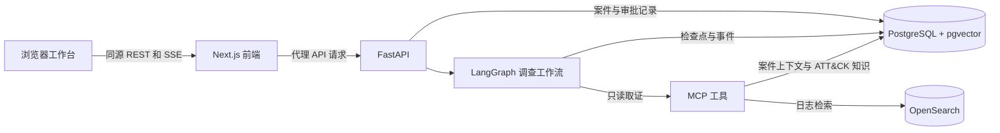

# EvidenceSOC · 证链

EvidenceSOC 是面向安全运营的告警调查工作台。它把日志证据、攻击链、响应方案、人工审批和效果验证串在同一个案件里。评审可以从攻击链步骤打开引用的原始日志，查看证据的 SHA-256 完整性校验，并追踪每个调查角色的运行记录。

仓库提供一组 SQL 注入合成日志，支持无需 API Key 的规则演示。批准方案后，系统在本地模拟器中记录控制状态变化。拒绝方案会结束流程。普通案件缺少效果证据时会进入人工复核。

[查看参赛报告 PDF](<reports/证链_EvidenceSOC_基于证据链与多智能体协作的安全告警调查与响应平台.pdf>)

## 技术架构



- **前端**使用 Next.js、React 和 TypeScript。攻击链图谱使用 React Flow，证据与运行记录通过侧栏查看。
- **后端**使用 FastAPI 和 LangGraph。工作流依次负责分诊、取证、分析、攻击链重构、响应决策和效果验证。响应方案经人工批准后才进入模拟处置，浏览器通过 SSE 接收进度并在重连后恢复显示。
- **数据层**由 PostgreSQL、pgvector 和 OpenSearch 组成。PostgreSQL 保存案件、原始证据、审批、工作流检查点和知识向量，OpenSearch 用于日志检索。MCP 工具在服务端校验案件范围和查询参数。

| 目录 | 内容 |
| --- | --- |
| [`apps/web`](apps/web/) | 工作台、同源 API 代理和浏览器测试 |
| [`services/backend`](services/backend/) | API、调查工作流、MCP、数据库迁移和后端测试 |
| [`infra`](infra/) | 数据库初始化、OpenSearch 索引模板和隔离验收配置 |
| [`scripts`](scripts/) 与 [`data/samples`](data/samples/) | 演示数据、导入脚本和验收工具 |
| [`docs`](docs/) 与 [`evals`](evals/) | 演示文档、安全模型和评测代码 |

## 环境配置

以下步骤以 Windows PowerShell 为例，所有命令均从仓库根目录执行。项目验收环境使用 Node.js 24.15.0、pnpm 11.19.0、Python 3.12.14 和 uv 0.12.16。启动 Docker，并确认 `docker compose version` 可用且 Docker 正在运行 Linux 容器。

前端依赖由 [pnpm 锁文件](pnpm-lock.yaml)固定，后端依赖由 [项目配置](services/backend/pyproject.toml)和 [uv 锁文件](services/backend/uv.lock)固定。[Compose 配置](compose.yaml)提供 PostgreSQL 17（含 pgvector）和 OpenSearch 3.8.0。首次准备环境需联网获取依赖、镜像、固定版本的 ATT&CK 数据和本地嵌入模型。

从 [`.env.example`](.env.example)复制根目录 `.env`，已有 `.env` 时沿用本机配置。

```powershell
if (-not (Test-Path -LiteralPath '.env')) {
  Copy-Item -LiteralPath '.env.example' -Destination '.env'
}
pnpm install --frozen-lockfile
uv sync --project services/backend --locked
```

| 配置 | 用途 |
| --- | --- |
| `POSTGRES_DB`、`POSTGRES_USER`、`POSTGRES_PASSWORD`、`DATABASE_URL` | 默认连接 `127.0.0.1:5432`。数据库名、用户和密码须与连接串一致。 |
| `OPENSEARCH_PORT`、`OPENSEARCH_URL` | 默认使用 `9200`。若已有本机服务使用其他端口，将 URL 与实际端口对齐。 |
| `RAG_DATA_DIRECTORY` | ATT&CK 知识与嵌入模型目录，默认 `data/knowledge`。 |
| `LLM_MODE`、`DEMO_SESSION_ENABLED`、`DEMO_SQLI_ENABLED` | 规则模式使用 `fixture`。演示会话和 SQL 注入演示默认关闭，按启动步骤显式开启。 |
| `DEMO_SQLI_DIRECTORY` | SQL 注入演示的本地登记目录，默认 `.tmp/sqli-demo`。自定义时，后端和导入脚本使用同一路径。 |
| `FRONTEND_ORIGIN`、`BACKEND_URL` | 浏览器访问地址为 `http://127.0.0.1:3000`，前端代理的后端地址为 `http://127.0.0.1:8000`。前后端的 `FRONTEND_ORIGIN` 要与浏览器地址完全一致，末尾省略斜杠。`BACKEND_URL` 在前端终端设置。 |
| `DEEPSEEK_API_KEY`、`DEEPSEEK_BASE_URL`、`DEEPSEEK_MODEL` | DeepSeek 模式使用。规则演示可将 API Key 留空。密钥保存在本机 `.env` 或进程环境。 |

## 安装后运行规则演示

### 1. 启动依赖和后端

在第一个 PowerShell 窗口启动依赖、执行数据库迁移，再准备知识库。已有 PostgreSQL 和 OpenSearch 时，核对 `.env` 指向现有服务后，从迁移命令开始。首次准备知识库需要下载和校验数据，等命令执行成功再启动后端。

```powershell
Remove-Item Env:SSLKEYLOGFILE -ErrorAction SilentlyContinue
docker compose up -d --wait postgres opensearch
uv run --project services/backend alembic -c services/backend/alembic.ini upgrade head
uv run --project services/backend python -m evidencesoc.rag.cli prepare

$env:LLM_MODE = 'fixture'
$env:DEMO_SESSION_ENABLED = 'true'
$env:DEMO_SQLI_ENABLED = 'true'
$env:FRONTEND_ORIGIN = 'http://127.0.0.1:3000'
uv run --project services/backend uvicorn evidencesoc.main:app --app-dir services/backend/src --host 127.0.0.1 --port 8000
```

### 2. 启动前端

在第二个 PowerShell 窗口执行以下命令，然后打开 [工作台](http://127.0.0.1:3000)。

```powershell
$env:BACKEND_URL = 'http://127.0.0.1:8000'
$env:FRONTEND_ORIGIN = 'http://127.0.0.1:3000'
pnpm --dir apps/web dev
```

需要运行生产构建时，在同一窗口停止开发服务，先运行 `pnpm --dir apps/web build`，构建成功后运行 `pnpm --dir apps/web start`。

### 3. 导入样例并完成调查

在第三个 PowerShell 窗口确认后端返回 `{"status":"ok"}`，再运行导入脚本。

```powershell
Remove-Item Env:SSLKEYLOGFILE -ErrorAction SilentlyContinue
curl.exe -f http://127.0.0.1:8000/health/ready
uv run --project services/backend python scripts/seed-sqli-demo.py --include-reject
```

1. 打开脚本输出中的 `alerts.fixture.url`，启用本地演示账户并启动规则调查。
2. 在攻击链中选择步骤，打开证据抽屉，查看原始日志及 SHA-256 校验。
3. 检查响应目标、影响、回滚和验证条件，填写理由并批准。效果验证会显示两条模拟观测，`network_blocked` 从 `false` 变为 `true`。
4. 如需展示拒绝流程，打开 `alerts.reject.url`，在独立案件中填写理由并拒绝。

两种模型模式、重复导入和 CMD 命令见 [SQL 注入双模式演示](docs/sql-injection-demo.md)。服务面向本机演示，处置动作仅改变模拟器状态。权限、数据隔离和故障恢复见 [安全模型](docs/security-model.md)。

## 开发检查

```powershell
pnpm --dir apps/web lint
pnpm --dir apps/web typecheck
pnpm --dir apps/web test
```

浏览器专项和生产回归的前置条件、命令和验收隔离方式见 [前端开发与验收说明](apps/web/README.md)。

## 团队信息

| 项目 | 内容 |
| --- | --- |
| 队名 | YG |
| 成员及分工 | 龚一夫 |
| 指导教师（如适用） | 汤毅豪 |
